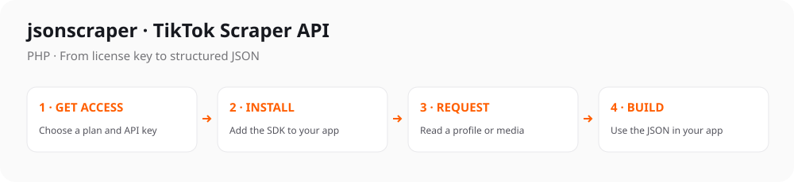

# TikTok Scraper API for PHP

[](https://github.com/evelode/tiktok-api-php/tags)
[](#quick-start)
[](https://github.com/evelode/tiktok-api-php/commits)
[](LICENSE)
[](https://packagist.org/packages/evelode/tiktok-api-php)
[](https://packagist.org/packages/evelode/tiktok-api-php)
[](https://www.postman.com/evelode/workspace/evelode/collection/24862082-d886cc87-4267-4e0c-b57a-2d083add50ad)

Composer client with **LazyJsonMapper response models** and ready-to-run examples. Supports **54 TikTok Scraper API methods**.

**Package:** `evelode/tiktok-api-php` · **[Methods](#main-methods)** · **[Examples](#ready-to-run-examples)** · **[Documentation](docs/guide.md)**



## Quick start

**1. Get your key** from the [TikTok API product page](https://jsonscraper.com/services/tiktok-scraper-api?utm_source=github&utm_medium=sdk&utm_campaign=evelode-tiktok-api-php&utm_content=readme) and set it on your server:

```sh
export JSONSCRAPER_TIKTOK_LICENSE_KEY='your-license-key'
```

**2. Install the package:**

```sh
composer require evelode/tiktok-api-php:^2.0
```

**3. Make a request:**

```php
<?php
require __DIR__.'/vendor/autoload.php';

$client = new TikTokRESTAPI\TikTok(getenv('JSONSCRAPER_TIKTOK_LICENSE_KEY'));
$client->setCacheTimeout(60);
$response = $client->getUserInfo('therock');
if ($response->isOk() && $response->getTiktok()?->isUser()) {
    echo $response->getTiktok()->getUser()->getUniqueId();
}
```

The API payload is in `tiktok`. Live calls require a valid API license and may consume quota. [Response examples and status handling](docs/responses.md).

## Main methods

54 methods are available. Common starting points:

| What you need | Method |
| --- | --- |
| Read a profile | `getUserInfo()` |
| Read a video | `getVideoByID()` |
| Get a video download URL | `getNoWatermarkUrl()` |
| Read comments | `getCommentsByID()` |
| Search videos | `searchVideo()` |
| List profile videos | `getUserFeed()` |

[All methods and parameters →](docs/endpoints.md)

## Ready-to-run examples

- [Read a profile](examples/getUserInfo.php).
- [Read a video](examples/getVideoByID.php).
- [Read comments](examples/getCommentsByID.php).
- [Search videos](examples/searchVideo.php).
- [List profile videos](examples/getUserFeed.php).
- [Video, author, statistics and playback URL models](examples/models.php).

Each example includes command-line parameters, key setup, timeouts, error handling and response output. Run it with `--help` first; this makes no API request.

**[Browse all 54 complete examples](examples/README.md)** · **[Full method and parameter reference](docs/endpoints.md)**

## Response models

The PHP client uses **Guzzle + LazyJsonMapper**. A response is an `APIResponse` with nested models and readable getters:

```php
$video = $response->getTiktok()?->getAwemeDetail();
echo $video?->getAuthor()?->getNickname();
echo $video?->getStatistics()?->getPlayCount();
```

[Model hierarchy and complete usage guide](docs/models.md) · [All model classes](src/Response/Model)

## Upgrading from 1.x

Version 2 requires **PHP 8.1+**. The `TikTokRESTAPI` namespace and existing positional methods are retained. [Compatibility and migration details](docs/guide.md#existing-evelode-users).

## Configuration

Requests use a 30-second timeout by default. Configure caching and retries to fit your application's request budget. Keys are read from your server environment; redirects are disabled.

[Configuration options, HTTP errors, caching and pagination](docs/configuration.md) · [Full integration guide](docs/guide.md)

## Use with ChatGPT and Codex

Prefer an assistant connection? Use the separate [TikTok MCP server](https://jsonscraper.com/mcp/tiktok?utm_source=github&utm_medium=sdk&utm_campaign=evelode-tiktok-api-php&utm_content=mcp). It accepts the same product API license and uses the normal API quota. [MCP source and setup](https://github.com/jsonscraper/tiktok-mcp-server).

## Access, pricing and support

The SDK source is **MIT-licensed**. Hosted API access requires a separate TikTok license. Check [current plans and get access](https://jsonscraper.com/services/tiktok-scraper-api?utm_source=github&utm_medium=sdk&utm_campaign=evelode-tiktok-api-php&utm_content=readme).

[Service support](https://jsonscraper.com/contacts?utm_source=github&utm_medium=sdk&utm_campaign=evelode-tiktok-api-php&utm_content=support) · [SDK issues](https://github.com/evelode/tiktok-api-php/issues) · [Changelog](CHANGELOG.md) · [MIT license](LICENSE)

## Development

```sh
composer test
```

Tests use a local/mock server and require no API key. A [GitHub Actions template](docs/github-actions.yml) is available for optional automation.

The SDK has no installation or usage telemetry. README links use campaign parameters for website referral analytics. jsonscraper is independent and is not affiliated with TikTok.
